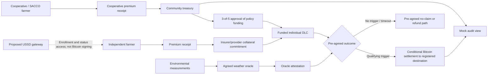

# LimaSats — Bitcoin-Powered Parametric Agricultural Insurance

**When the rains fail, protection pays.**

> **Simulation — No real funds.** LimaSats is an educational frontend prototype. It does not issue insurance, calculate a binding quote, move Bitcoin, or connect to a telecom network.

## Overview

LimaSats explores how predefined environmental indices and conditional Bitcoin settlement could support smallholder crop and livestock farmers in Kenya and, eventually, other African markets. The current app is a clickable React simulation with fictional farmers in Kisumu, Kitui, and Turkana. All farmer records, wallet destinations, weather observations, signatures, oracle attestations, exchange rates, and transactions are mock data held in browser state.

## Project origin

LimaSats was created for the **Bitcoin DADA Ideathon, facilitated by Trezor**. This credit describes the event context and does not imply endorsement by Trezor.

## Problem statement

Smallholder farmers face drought, flooding, vegetation stress, crop and livestock losses, limited access to suitable cover, complex enrollment, and slow claims processes. Index insurance can reduce some claims friction by agreeing in advance which measurable condition triggers a settlement. It also introduces **basis risk**: an individual farmer may suffer a loss even when the index does not cross its threshold.

## Proposed solution

The concept combines farmer registration, an agreed environmental index, an insurance policy, a credible weather oracle, a funded Discreet Log Contract (DLC), and conditional Bitcoin settlement. A cooperative treasury can approve reserve spending and policy funding through 3-of-5 multisignature governance. That vote happens **before** an individual DLC is funded. Once funded, the DLC's pre-agreed settlement or refund path depends on the oracle outcome; community signers do not vote again on each qualifying payout.

The prototype demonstrates this sequence with frontend state only. Real insurance would require licensed underwriting, adequate reserves, robust data, secure custody, legal review, and payment partners.

## Key features in the current simulation

| Screen | What works now |
| --- | --- |
| Home | Product overview, simulated-flow launch, guided tour |
| Enroll a farmer | Independent or cooperative/SACCO registration, crop or livestock selection, package, farm size, mock destination, Leaflet polygon drawing, policy card, simulated premium payment |
| Insurance packages | Basic, Standard, and Premium illustrative cover and risk scope |
| AI premium estimator | Deterministic risk formula with county, location, asset, size, package, cover, and season inputs |
| Community treasury | Mock address and sats balance, five representatives, proposed funding allocations |
| Signing room | Frontend 3-of-5 allocation approval, recipient validation, tamper rejection, simulated funding broadcast |
| DLC explorer | Policy identifiers, funded collateral, oracle details, pre-agreed payout and refund paths |
| Trigger simulator | Rainfall and vegetation-index controls, hazard selection, farm impact map, exact formula-based payouts |
| Settlement | Mock oracle attestation and execution of a pre-agreed outcome without a second treasury vote |
| Public audit | Read-only ledger with type, farmer-category, date, and status filters |
| USSD experience | Interactive basic-phone menu and keypad using proposed shortcode `*XXX#` |

The guided tour remains available from the top navigation. Reloading the page resets the simulation.

## Independent farmers

Independent farmers can enroll without a cooperative, choose a package, review an illustrative premium, and simulate premium payment. A separate action commits mock insurer/provider collateral to an individual DLC. When a qualifying mock oracle attestation is published, the pre-agreed settlement path can pay the registered mock destination **without community signer approval**.

Keep these four values separate:

| Value | Meaning |
| --- | --- |
| Premium | Illustrative amount paid by the farmer for cover |
| Coverage | Maximum insurance benefit in the selected policy |
| DLC collateral | Mock Bitcoin value committed before the environmental event |
| Actual payout | Formula-derived amount for the attested event; it can be zero or less than maximum cover |

Mary Mutheu is the seeded independent example: Kitui maize, KES 10,000 maximum cover, and a drought threshold below 200 mm.

## Cooperative and SACCO farmers

Cooperative members can enroll with a cooperative name and simulate premium collection. Their proposed policy-funding allocation appears in the community treasury. Five representatives are shown: a cooperative officer, an elected farmer representative, an elected female farmer representative, a community elder, and a youth agripreneur. Any three can approve a **treasury allocation** in the demo. The tamper test adds an unregistered destination, causing frontend validation to reject the batch.

Approved funding marks the individual mock DLC as funded. An eventual qualifying payout follows that DLC's pre-agreed conditions and oracle attestation. The signing buttons are an interaction demo, **not cryptographic multisignature security**. Seeded cooperative policies are already marked funded so the weather-to-settlement demonstration works immediately; Juma Otieno provides a pending funding example.

## AI-assisted premium estimation

The page is labeled **“AI-assisted pricing concept — simulated risk estimates.”** It does **not** run a trained model. A deterministic formula uses seeded county risk values, cover, package factor, crop/livestock factor, farm-size factor, and season factor:

```text
premium (KES) =
  round(coverage × (0.035 + county risk × 0.12)
        × package factor × asset factor × size factor × season factor)
```

The prototype caps selected coverage at Basic KES 15,000, Standard KES 30,000, and Premium KES 60,000. The displayed risk category is based on seeded values for Kisumu, Kitui, and Turkana. Farm location is collected as context; the current formula prices at **county** granularity. The output is an illustration, not a quote or actuarially validated premium.

A future AI component would need historical weather and loss records, geographic data, trained and evaluated risk models, actuarial validation, and licensed insurance underwriting.

### Illustrative trigger math

Only risks included in the selected package can qualify: Basic covers drought, Standard adds flood, and Premium adds vegetation stress. The simulator rounds KES payouts to whole shillings and multiplies by the fixed demo rate of 18 sats per KES.

- **Drought:** below the policy's rainfall threshold, `cover × min(1, (threshold − rainfall) / threshold)`.
- **Flood:** above 450 mm, `cover × min(1, (rainfall − 450) / 250)`.
- **Vegetation stress:** below NDVI 0.35, `cover × min(1, (0.35 − NDVI) / 0.35)`.

These simplified formulas are for interaction testing, not actuarially validated cover.

## USSD accessibility

The interactive phone demonstrates a proposed `*XXX#` menu for registration, packages, premium estimates, policy and weather status, payout status, and help. The shortcode has **not** been activated. The app has no telecom gateway or account backend.

Production support would require a USSD gateway, identity verification, secure account management, a premium collection/payment integration, SMS notifications, and suitable custody or payout arrangements for farmers without Bitcoin wallets or smartphones. **USSD alone does not let a basic phone securely sign Bitcoin transactions.**

## Bitcoin integration and settlement model

- **DLC:** counterparties agree on funding, oracle event, conditional contract execution transactions, and a refund/timeout path before the weather outcome. The app only represents those objects with mock text and state. The [DLC specification](https://github.com/discreetlogcontracts/dlcspecs/blob/master/Protocol.md) documents the real protocol.
- **Weather oracle:** a production oracle would publish a cryptographic attestation for the agreed event. The current button changes React state; it does not sign data. See the [DLC oracle specification](https://github.com/discreetlogcontracts/dlcspecs/blob/master/Oracle.md).
- **Multisignature treasury:** community approval governs cooperative reserve spending and DLC funding. It is separate from subsequent DLC settlement.
- **Conditional farmer payment:** an independent or cooperative funded policy can follow its pre-agreed payout path after a qualifying oracle outcome. The demo updates a mock sats balance and audit row.
- **Public record:** real on-chain transfers are independently inspectable, but private policy details, the truth of a weather measurement, and delivery of local-currency value are not proven by the chain alone.

Bitcoin network fees and exchange rates vary. Lightning may be useful for lower-cost payments in suitable situations, but a Lightning payment is not the same mechanism as an on-chain DLC contract execution transaction; the [Lightning Builder's Guide](https://docs.lightning.engineering/the-lightning-network/overview) describes its payment-channel model. Production KES conversion would require an appropriate regulated payment integration. The prototype fixes **1 KES = 18 sats solely as a demo conversion**, not a market rate.

## System architecture



All arrows are a **proposed architecture**. Only browser-level simulation logic is implemented.

## Example user journey

1. Open **AI premium estimator** and review an illustrative package, risk category, premium, and factors.
2. In **Enroll a farmer**, choose independent or cooperative participation, enter the farm details, and select or draw a polygon.
3. Simulate the premium receipt. An independent sample then has a separate provider-collateral step; a cooperative sample enters the treasury's pending allocation list.
4. For a cooperative sample, open **Signing room**, optionally run the tamper test, restore the valid batch, and collect three mock approvals to fund the DLC.
5. Inspect the policy's pre-agreed terms in **DLC explorer**.
6. In **Trigger simulator**, set rainfall or vegetation index. A drought policy with a 200 mm threshold does not trigger at 250 mm and does trigger at 150 mm. Under the demo's proportional formula, Mary's KES 10,000 maximum cover yields a KES 2,500 illustrative payout at 150 mm (45,000 sats).
7. Generate the report, publish a **mock oracle attestation**, then execute the pre-agreed outcome in **Settlement**. The independent path uses no community signatures; the cooperative path does not require a second funding vote.
8. Inspect the mock entries and filters in **Public audit**.

## Technology stack

- **Language and framework:** TypeScript, React 19, Vite 8
- **Mapping:** Leaflet with OpenStreetMap tiles
- **Icons:** Lucide React
- **Styling:** CSS, Space Grotesk headings, Inter body; deep green `#10241F`, warm cream `#FAF5EA`, Bitcoin orange `#F2A33A`
- **State and data:** React hooks and seeded in-memory objects; no backend, database, real oracle, wallet connector, or telecom service
- **Checks:** TypeScript compiler, Vite production build, Node's built-in test runner

## Getting started

Prerequisites: a recent Node.js release with npm (the project was validated with Node.js 24). A network connection is needed to install packages, load web fonts, and display OpenStreetMap tiles.

```powershell
# Run from the repository root
npm ci
npm run dev
```

Open the local URL printed by Vite. To run checks and build the static site:

```powershell
npm test
npm run build
npm run preview
```

`npm run build` runs TypeScript checking and writes the static app to `dist/`. There are no environment variables to configure.

## Project structure

```text
app/
  page.tsx              Main navigation, enrollment, treasury, weather state
  pricing.ts            Shared deterministic premium and payout formulas
  Packages.tsx          Illustrative cover options
  PremiumEstimator.tsx  Interactive pricing concept
  DlcExplorer.tsx       Pre-agreed contract terms and roles
  TreasurySigning.tsx   Mock 3-of-5 policy-funding approval
  Settlement.tsx        Oracle attestation and conditional outcome
  PublicAudit.tsx       Read-only filtered mock ledger
  UssdExperience.tsx    Basic-phone menu simulator
  globals.css           Responsive visual system
tests/pricing.test.ts   Trigger boundaries and pricing checks
tests/render.test.mjs   Render checks for the main and new screens
main.tsx                React entry point
index.html              Browser metadata
public/favicon.svg      LimaSats icon
```

## Screenshots

Screenshots are not checked into the repository. Capture current screens from a local run before adding image references here.

## Current implementation status

| Implemented frontend simulation | Mocked, not operational | Planned production capability |
| --- | --- | --- |
| Forms, packages, map polygons, estimator, USSD menus, weather controls, filtered audit | Farmer identity, policy records, premiums, treasury signatures, Bitcoin addresses, sats balances, oracle attestation, DLC transactions, exchange rate | Real weather measurements and oracles, secure DLC and multisig implementations, licensed underwriting, durable records, payment/telecom integrations |

No live payout, real insurance coverage, machine-learning model, blockchain broadcast, or activated USSD shortcode exists in this repository.

## Roadmap

1. Validate policy design, basis risk, pricing, and reserve adequacy with farmers and licensed underwriters.
2. Integrate reliable weather and vegetation data at suitable geographic resolution.
3. Design and test a cryptographic oracle and DLC implementation on Bitcoin regtest or testnet.
4. Build real premium models with historical data, actuarial review, and fairness checks.
5. Explore secure multisig custody, reconciliation, and independent security testing.
6. Integrate a USSD gateway, identity management, SMS, and appropriate local-currency payout services.
7. Model Bitcoin volatility, transaction fees, Lightning use cases, conversion costs, and liquidity.
8. Complete insurance, payments, privacy, and consumer-protection regulatory review before any real-world launch.

## Risks and limitations

Oracle errors or manipulation, sparse environmental measurements, and geographic mismatch can cause wrong outcomes. Basis risk can leave a farmer uncompensated despite an actual loss. Bitcoin volatility and on-chain fees affect the value and cost of cover. Insufficient reserves or poor custody could prevent payment. Insurance and payment services require appropriate regulatory treatment. Policy and location data require strong privacy controls. Connectivity and phone ownership vary across regions. None of these risks is solved by the current frontend demo.

## Credits

Created for the **Bitcoin DADA Ideathon, facilitated by Trezor**. No official endorsement is claimed.

## Disclaimer

LimaSats is an educational ideathon simulation. It provides **no real insurance, financial advice, or financial services**. All amounts, risk values, farmers, addresses, attestations, and transaction IDs are illustrative.

## License

No license file is included, at the project owner's request.
